<p align="center">
  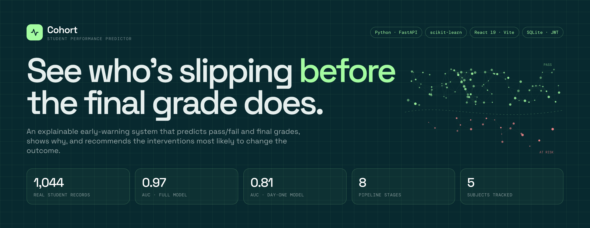
</p>

<p align="center">
  
  
  
  
  
  
</p>

<p align="center">
  <b>An explainable early-warning system for secondary-school students.</b><br>
  It predicts who will pass or fail and what grade they'll get, explains <i>why</i>, and recommends the interventions most likely to change the outcome.
</p>

<p align="center">
  <a href="#-quick-start">Quick start</a> ·
  <a href="#-screenshots">Screenshots</a> ·
  <a href="#-system-architecture">Architecture</a> ·
  <a href="#-machine-learning-pipeline">ML pipeline</a> ·
  <a href="#-prediction-lifecycle">Lifecycle</a> ·
  <a href="#-api-reference">API</a> ·
  <a href="#-research-basis">Research</a>
</p>

---

## ✦ Highlights

<table>
<tr>
<td width="33%" valign="top">

**🎯 Two-regime prediction**<br>
A *day-one* model that needs no grades (AUC **0.81**) and a *mid-year* model that uses period grades (AUC **0.97**). The right one is picked automatically.

</td>
<td width="33%" valign="top">

**🔍 Every score explained**<br>
Baseline-substitution attribution shows how much each factor pushes the pass probability up or down, in percentage points.

</td>
<td width="33%" valign="top">

**🧭 Counterfactual planner**<br>
Realistic changes to *actionable* factors are re-scored by the model and greedily combined into a plan, with the predicted gain for each step.

</td>
</tr>
<tr>
<td valign="top">

**🧪 Pipeline in the open**<br>
An 8-stage training pipeline. Admins can retrain from the browser and watch each stage run live, with a streaming log.

</td>
<td valign="top">

**📊 Honest evaluation**<br>
The dashboard cohort is the 20% hold-out set the model never saw, so *predicted vs actual* is a real-world accuracy check.

</td>
<td valign="top">

**🔐 Production basics**<br>
JWT auth, bcrypt hashing, admin/teacher roles, CSV bulk import, an audit trail of training runs, and a responsive UI.

</td>
</tr>
</table>

---

## 📸 Screenshots

<table>
<tr>
<td colspan="2">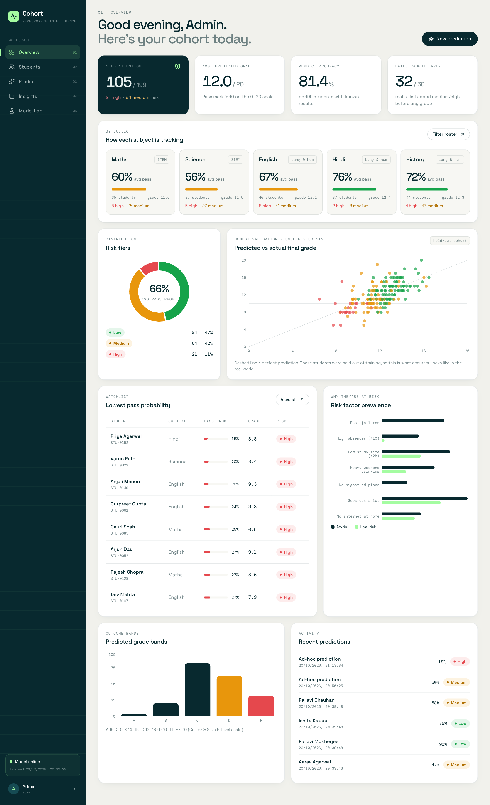<br>
<sub><b>Overview</b>: KPIs, per-subject tracking, risk tiers, predicted vs actual on unseen students, watchlist, risk-factor prevalence.</sub></td>
</tr>
<tr>
<td width="50%">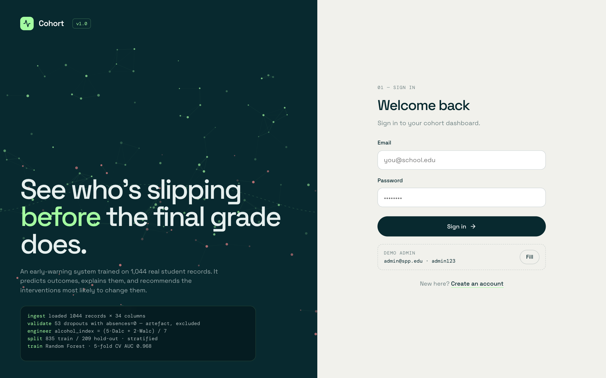<br>
<sub><b>Sign in</b>: an animated "cohort field" of students drifting into pass/at-risk basins, with a live pipeline terminal.</sub></td>
<td width="50%">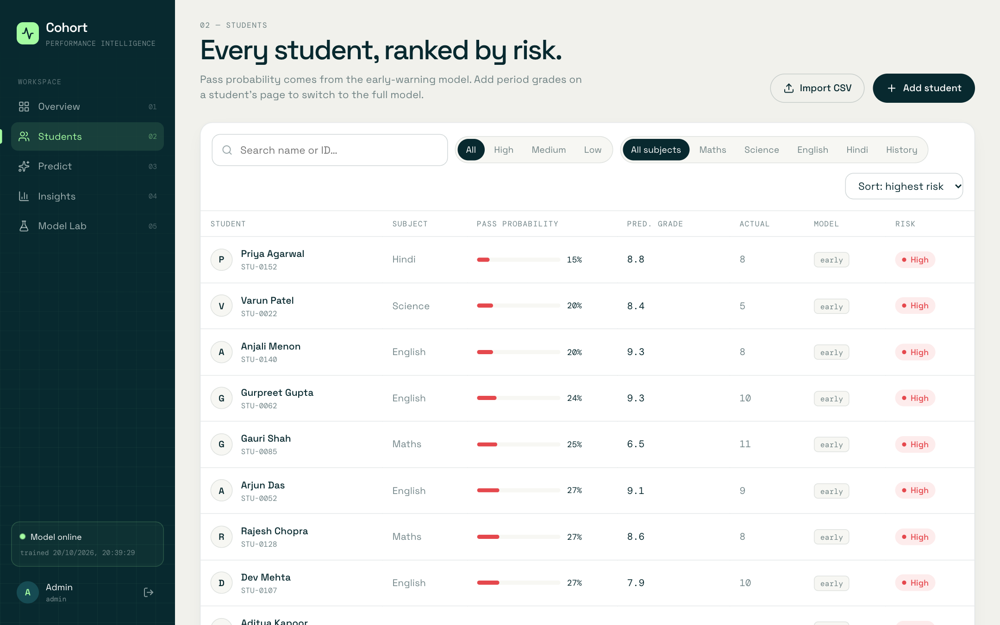<br>
<sub><b>Students</b>: ranked by risk, with search, risk and subject filters, CSV import and pagination.</sub></td>
</tr>
<tr>
<td width="50%">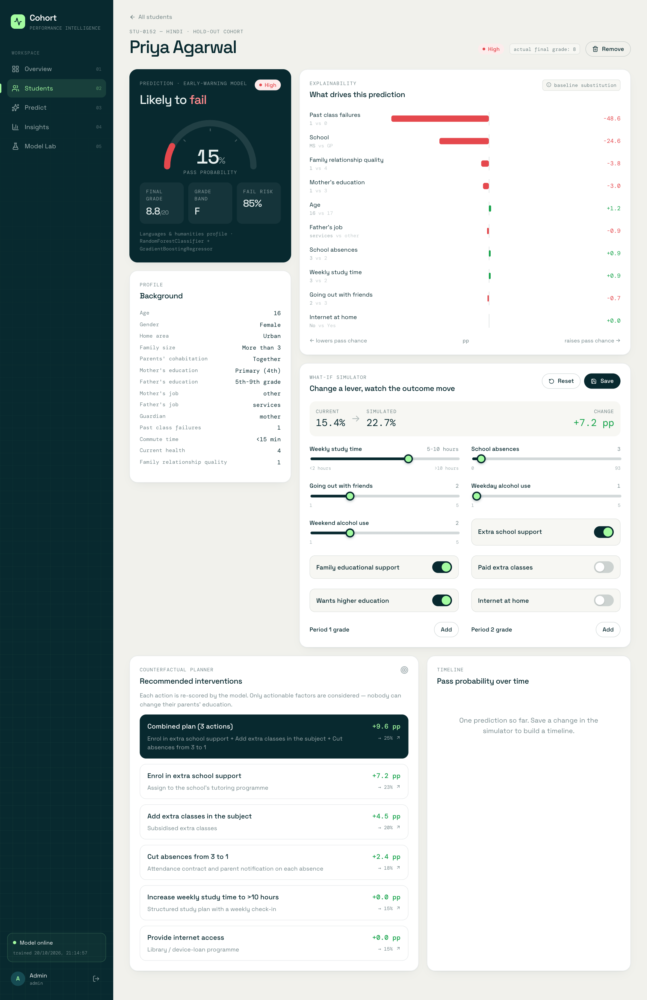<br>
<sub><b>Student detail</b>: the verdict, why it was made, a what-if simulator (here +7.2 pp from extra school support) and a ranked intervention plan.</sub></td>
<td width="50%">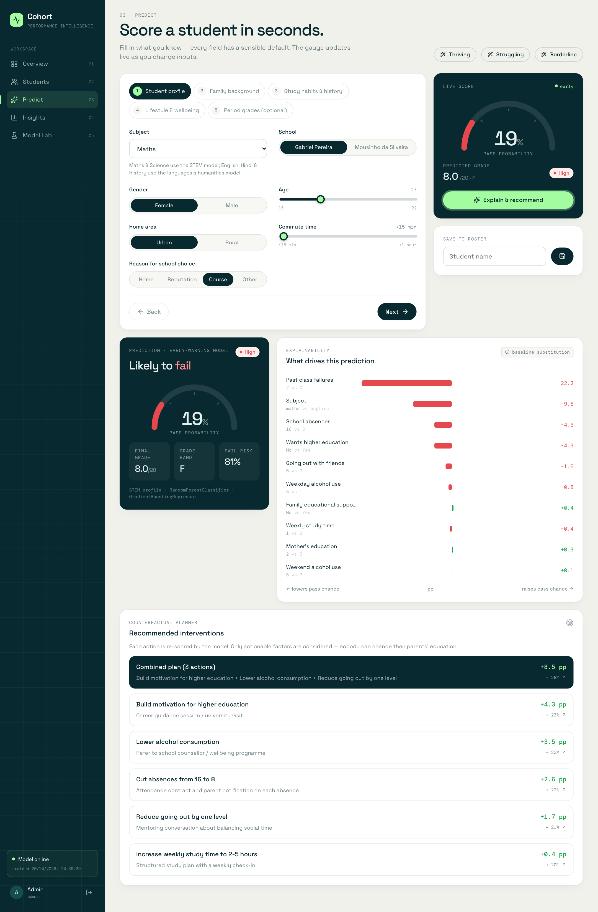<br>
<sub><b>Predict</b>: a 5-step form with a live-updating gauge, then the full explanation and plan.</sub></td>
</tr>
<tr>
<td width="50%">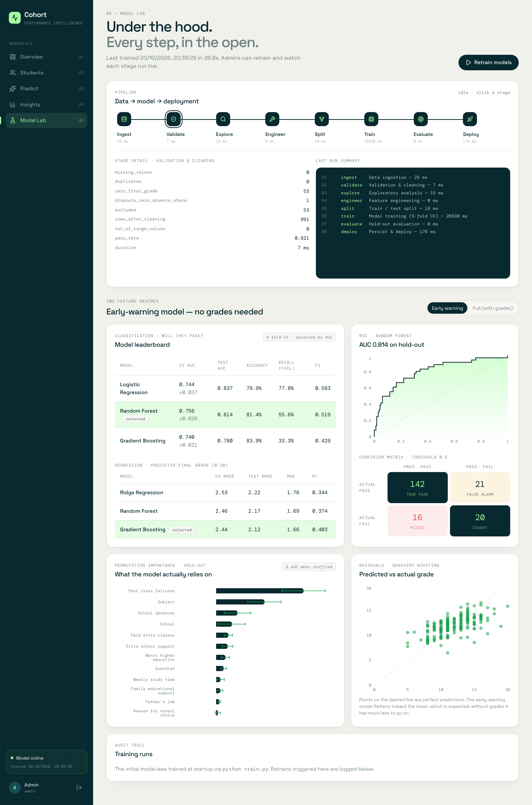<br>
<sub><b>Model Lab</b>: pipeline stages, leaderboards, ROC curve, confusion matrix, permutation importance and residuals.</sub></td>
<td width="50%">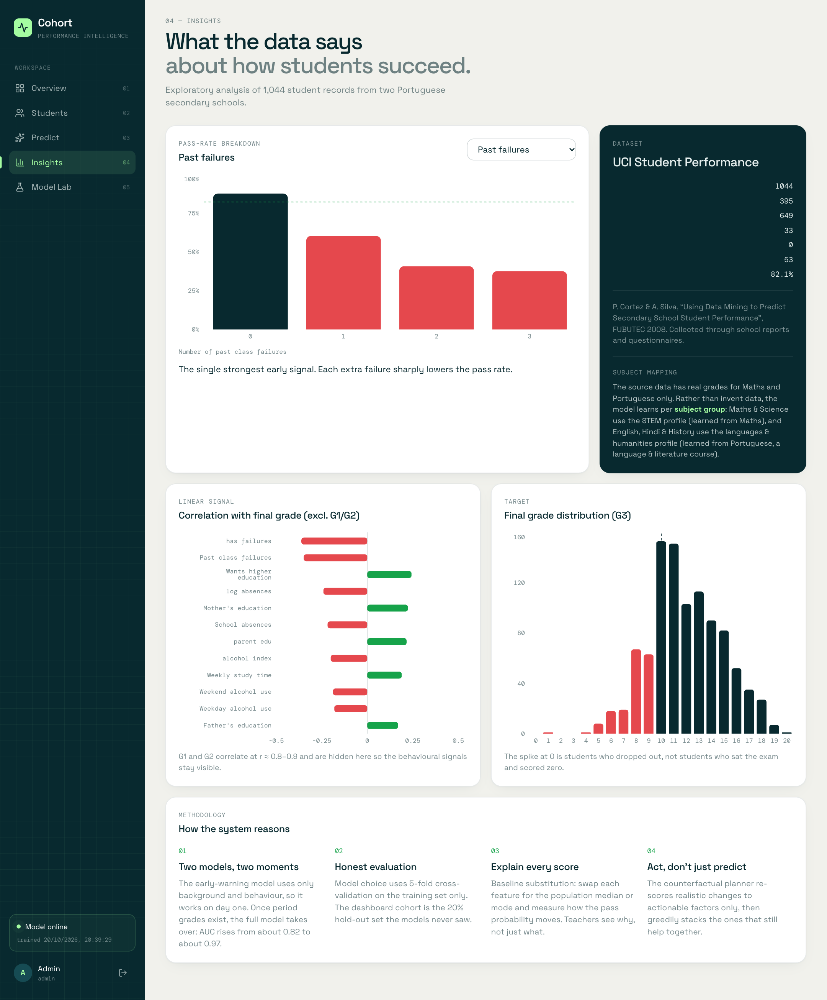<br>
<sub><b>Insights</b>: exploratory analysis, correlations, grade distribution and methodology.</sub></td>
</tr>
<tr>
<td width="50%">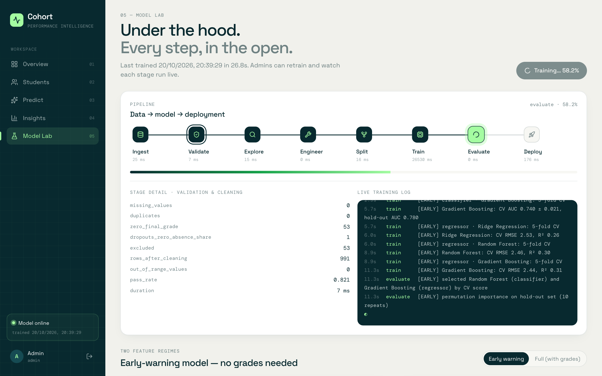<br>
<sub><b>Live retraining</b>: the Evaluate stage running at 58% with a streaming log of every CV score.</sub></td>
<td width="50%">
<table><tr>
<td>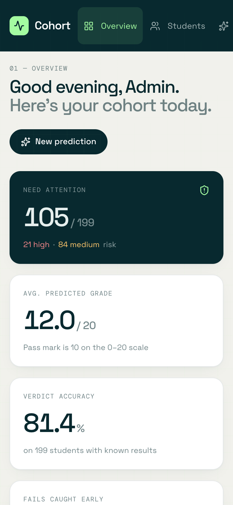</td>
<td>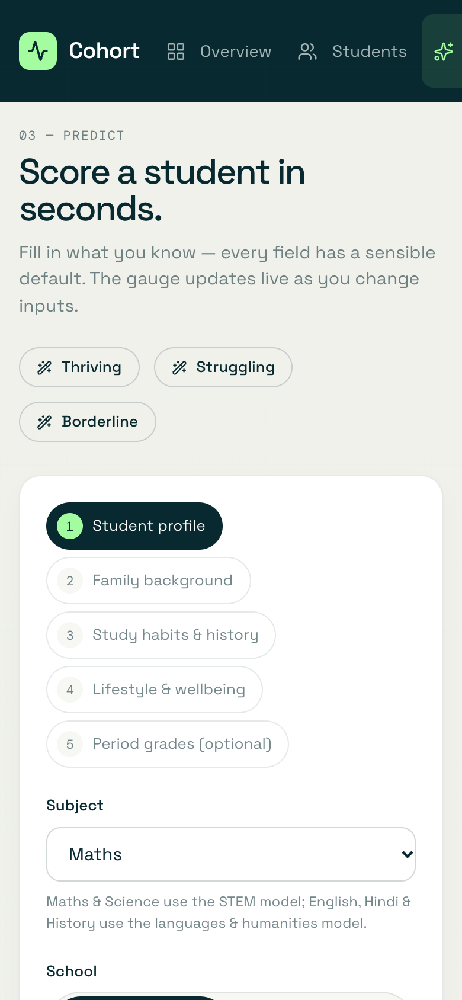</td>
</tr></table>
<sub><b>Responsive</b>: the full experience on a 390 px phone.</sub></td>
</tr>
</table>

---

## 🏛 System architecture

<p align="center">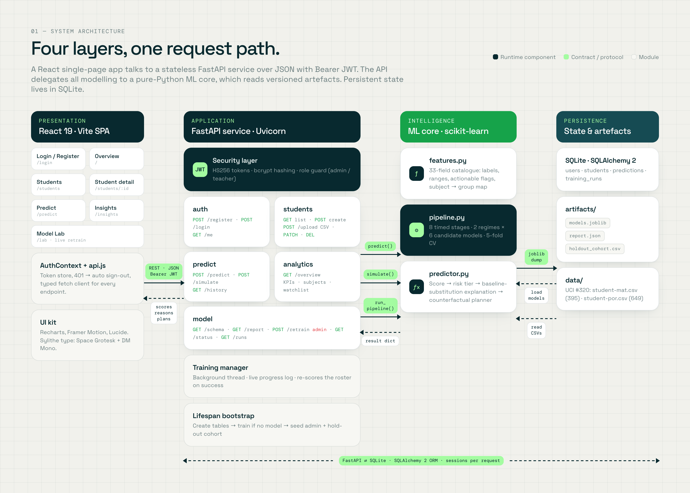</p>

| Layer | Responsibility | Key files |
|---|---|---|
| **Presentation** | React 19 SPA, routing, auth context, data-viz, motion | `frontend/src/pages/*`, `api.js`, `auth.jsx` |
| **Application** | REST API, JWT security, role guard, background training, bootstrap | `backend/app/main.py`, `routers/*`, `security.py`, `training.py` |
| **Intelligence** | Feature catalogue, training pipeline, scoring, explanation, planning | `backend/app/ml/features.py`, `pipeline.py`, `predictor.py` |
| **Persistence** | Users, roster, prediction history, training audit; model artefacts | `models.py`, `artifacts/`, `data/` |

**Design decisions**
- **The ML core is framework-free.** `app/ml` has no FastAPI imports, so the CLI (`train.py`), the API and the background trainer all share exactly the same code.
- **Scores are denormalised onto `students`** for fast list and dashboard queries, while `predictions` keeps the full append-only history for timelines.
- **Hot model swap.** After a retrain the predictor reloads from disk and every student is re-scored, with no server restart.
- **One pickled object per model.** Feature engineering, one-hot encoding, scaling and the estimator live in a single scikit-learn `Pipeline`, so training and serving can't drift apart.

---

## 🧠 Machine-learning pipeline

<p align="center">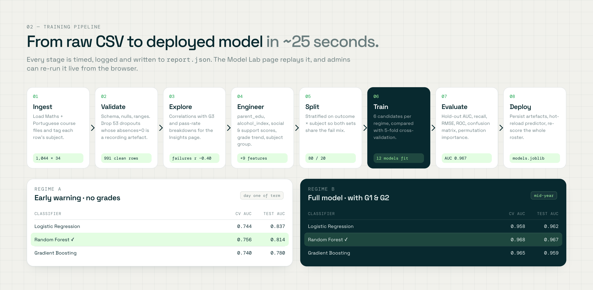</p>

| Stage | What happens |
|---|---|
| **01 Ingest** | Load `student-mat.csv` (395) and `student-por.csv` (649) from UCI #320 and tag the subject |
| **02 Validate** | Schema, nulls and range checks. **Finding:** all 53 dropouts (G3 = 0) have `absences = 0`, compared with 31% of everyone else. That's a recording artefact that teaches models "zero absences ⇒ fail", so those rows are excluded |
| **03 Explore** | Pearson correlations with G3 and pass-rate breakdowns (served to the Insights page) |
| **04 Engineer** | `parent_edu`, `alcohol_index = (5·Dalc + 2·Walc)/7`, `social_score`, `support_score`, `has_failures`, `log_absences`, `grade_trend`, `grade_mean`, `subject_group` |
| **05 Split** | Stratified 80/20 on outcome × subject |
| **06 Train** | Logistic Regression · Random Forest · Gradient Boosting (classifiers) and Ridge · RF · GB (regressors), compared with 5-fold CV for **both** regimes and selected by CV score |
| **07 Evaluate** | Hold-out AUC, accuracy, recall, F1, RMSE, R², ROC curve, confusion matrix, permutation importance |
| **08 Deploy** | `models.joblib`, `report.json` and `holdout_cohort.csv`, then hot-reload |

### Results on the hold-out set (unseen students)

| Regime | When | Classifier | AUC | Accuracy | Fail recall | Regressor | RMSE | R² |
|---|---|---|---|---|---|---|---|---|
| **Early warning** | Day one: no grades | Random Forest | **0.814** | 81.4% | 55.6% | Gradient Boosting | 2.12 | 0.40 |
| **Full** | Mid-year: with G1 & G2 | Random Forest | **0.967** | 90.0% | 94.4% | Ridge Regression | 0.86 | 0.90 |

At the risk-tier level (medium or high), the early-warning model flags **32 of the 36** dashboard students who really failed, before any grade exists.

```bash
cd backend && .venv/bin/python train.py     # reproduce the whole run from the CLI
```

---

## ⚡ Prediction lifecycle

<p align="center">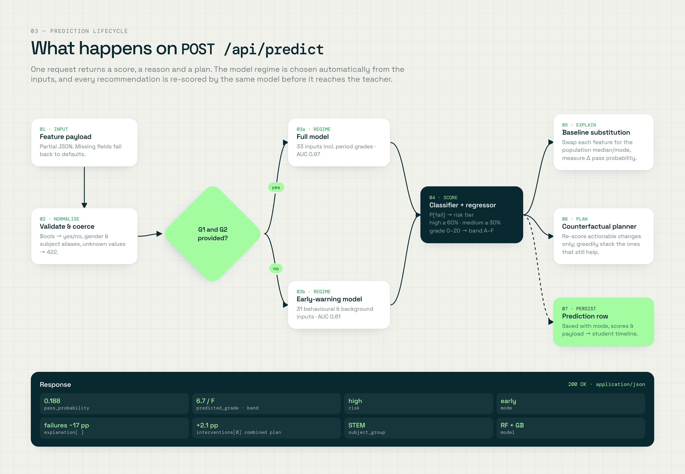</p>

1. **Normalise.** Partial payloads are filled with defaults. Booleans, gender (`Female`/`Male`) and subject aliases are coerced, and unknown values return **422**.
2. **Select regime.** If both `G1` and `G2` are present the full model is used; otherwise the early-warning model.
3. **Score.** The classifier gives `P(fail)`, which maps to a risk tier (high ≥ 60%, medium ≥ 30%). The regressor gives a 0–20 grade, which maps to a band A–F (Cortez & Silva 5-level scale).
4. **Explain.** *Baseline substitution*: each feature is swapped for the population median or mode, and the change in pass probability is that feature's contribution.
5. **Plan.** Only *actionable* levers are considered: study time, absences, going out, alcohol, school/family support, extra classes, higher-ed motivation and internet. Each change is re-scored, then a greedy search stacks the changes that still help on top of each other. The models are non-additive, so "apply everything" can backfire.
6. **Persist.** A `predictions` row is written and the student's timeline grows.

---

## 🧭 User workflow

<p align="center">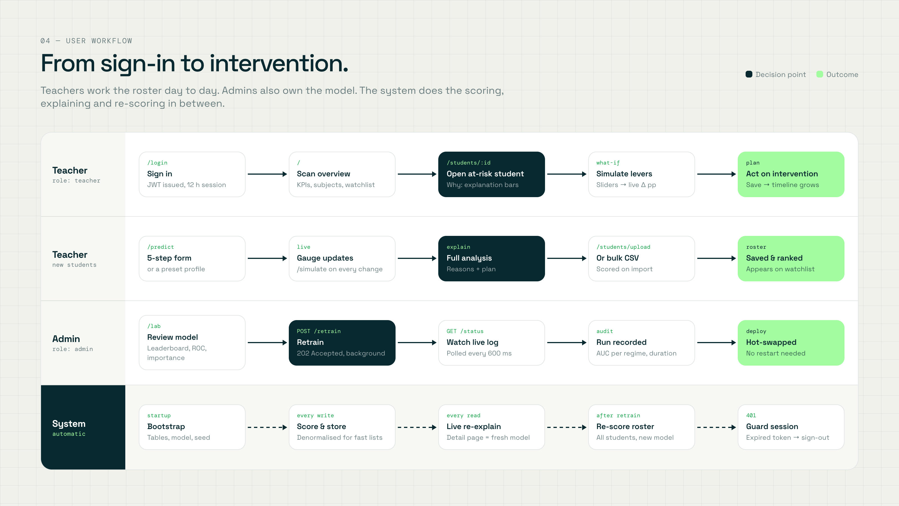</p>

### Authentication sequence

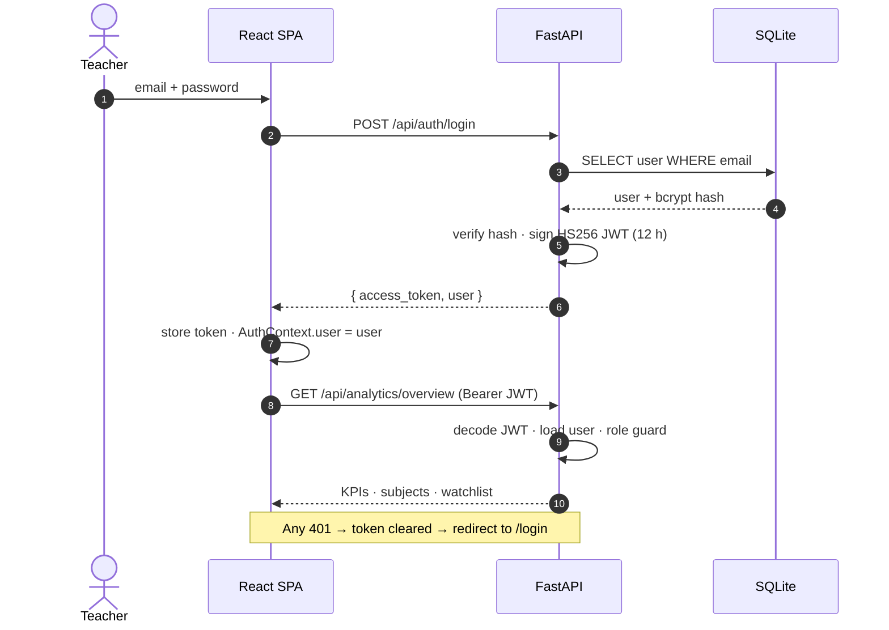

### Live retraining sequence

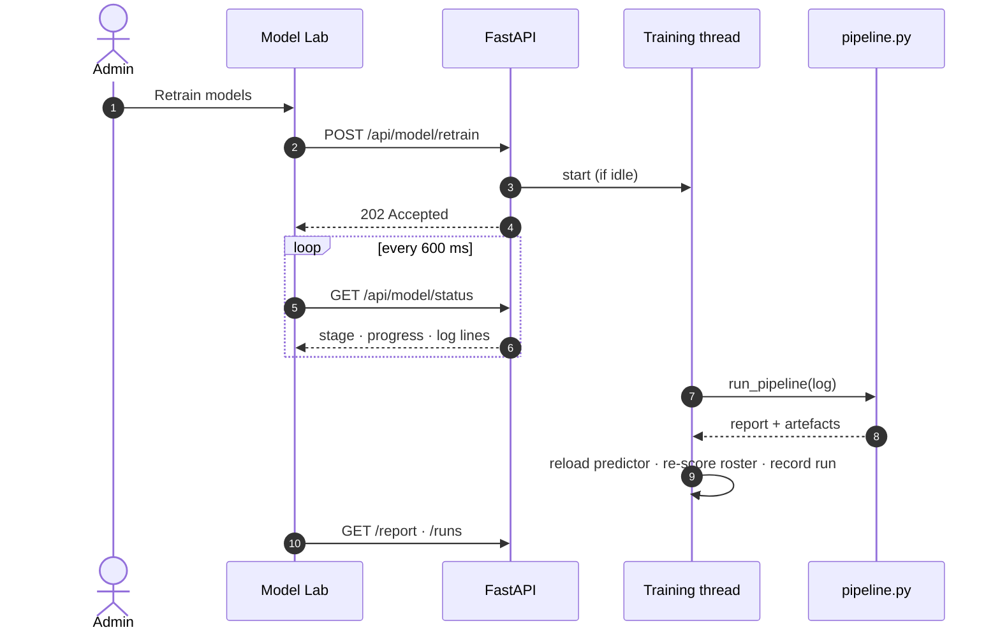

---

## 🗄 Data model

<p align="center">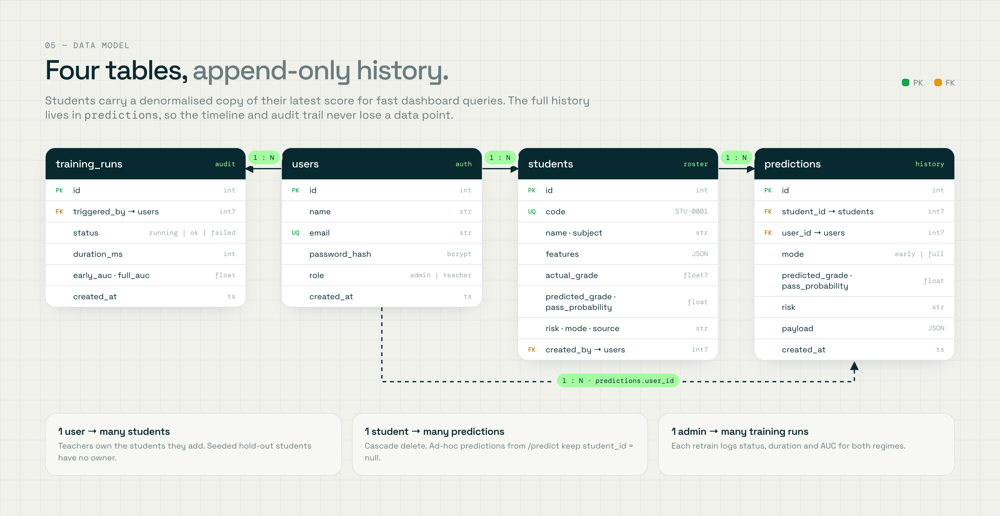</p>

---

## 🧰 Tech stack

| | Technology | Why |
|---|---|---|
| **API** | FastAPI · Uvicorn · Pydantic v2 | Typed request validation, auto OpenAPI docs at `/docs` |
| **ML** | scikit-learn · pandas · NumPy · joblib | Pipelines bundle feature engineering + preprocessing + model in one picklable object |
| **Data** | SQLAlchemy 2 · SQLite | Zero-config persistence; switch to Postgres via `SPP_DATABASE_URL` |
| **Auth** | python-jose (JWT) · passlib (bcrypt) | Stateless sessions, salted password hashes, role-based guard |
| **UI** | React 19 · React Router 7 · Vite 8 | Fast dev loop, code organised by page |
| **Viz & motion** | Recharts · Framer Motion · Lucide | Charts, animated gauges, page transitions |
| **Design** | Space Grotesk · DM Mono | Typography and palette taken from [sylithe.com](https://sylithe.com) |

<details>
<summary><b>Design tokens</b></summary>

| Token | Value | Use |
|---|---|---|
| `--ink` | `#08292F` | Primary text, dark surfaces, sidebar |
| `--mint` | `#A4FCA1` | Signal accent, focus rings, active state |
| `--green` | `#16A34A` | Positive impact, low risk |
| `--canvas` | `#F1F1EC` | App background |
| `--high` / `--medium` | `#E5484D` / `#E8960C` | Risk tiers |

</details>

---

## 🚀 Quick start

**Prerequisites:** Python 3.11+ (tested on 3.13) and Node.js 20+.

```bash
git clone https://github.com/karan27-dev/SC.git
cd SC
./start.sh
```

`start.sh` creates the virtualenv, installs dependencies, starts the API on **:8000** and the web app on **:5180**. On first boot the API trains the models (~25 s) and seeds the database.

| | URL |
|---|---|
| Web app | http://localhost:5180 |
| API | http://localhost:8000 |
| Swagger / OpenAPI | http://localhost:8000/docs |

**Demo login:** `admin@spp.edu` / `admin123` (admin). You can also register a teacher account.

<details>
<summary><b>Manual setup</b></summary>

```bash
# backend
cd backend
python3 -m venv .venv
.venv/bin/pip install -r requirements.txt
.venv/bin/python train.py                         # optional: startup trains if needed
.venv/bin/uvicorn app.main:app --port 8000 --reload

# frontend (new terminal)
cd frontend
npm install
npx vite --port 5180                              # /api is proxied to :8000
```
</details>

<details>
<summary><b>Configuration</b></summary>

| Variable | Default | Purpose |
|---|---|---|
| `SPP_SECRET_KEY` | dev key | JWT signing secret. **Set this in production** |
| `SPP_TOKEN_TTL` | `720` | Token lifetime in minutes |
| `SPP_DATABASE_URL` | `sqlite:///backend/spp.db` | Any SQLAlchemy URL |
| `SPP_CORS_ORIGINS` | `localhost:5173,5180` | Comma-separated allowed origins |
| `VITE_API_URL` | *(empty, uses proxy)* | Frontend API base for deployed builds |

</details>

---

## 📡 API reference

All endpoints except auth, `/api/health` and `/api/model/schema` require `Authorization: Bearer <token>`.

| Method | Endpoint | Description |
|---|---|---|
| `POST` | `/api/auth/register` | Create a teacher account `{name, email, password}` → token |
| `POST` | `/api/auth/login` | `{email, password}` → `{access_token, user}` |
| `GET` | `/api/auth/me` | Current user |
| `GET` | `/api/health` | Liveness + model status |
| `GET` | `/api/analytics/overview` | KPIs, per-subject breakdown, risk distribution, validation, watchlist |
| `GET` | `/api/students` | `q`, `risk`, `subject`, `sort` (risk/grade/name/recent), `page`, `size` |
| `POST` | `/api/students` | Create + score `{name, features, actual_grade?}` |
| `POST` | `/api/students/upload` | Bulk CSV import (multipart `file`). See `samples/new_students.csv` |
| `GET` | `/api/students/{id}` | Student + live prediction, explanation, interventions, history |
| `PATCH` | `/api/students/{id}` | Update features → re-score |
| `DELETE` | `/api/students/{id}` | Remove a student |
| `POST` | `/api/predict` | Full prediction `{features, student_id?, save?}` |
| `POST` | `/api/predict/simulate` | Fast what-if score (not persisted) |
| `GET` | `/api/predict/history` | Your recent predictions |
| `GET` | `/api/model/schema` | Feature metadata that drives the UI form |
| `GET` | `/api/model/report` | Full training report: EDA, leaderboards, ROC, importance |
| `POST` | `/api/model/retrain` | Start background retraining · **admin** · `202` |
| `GET` | `/api/model/status` | Live progress + log |
| `GET` | `/api/model/runs` | Training-run audit trail |

<details>
<summary><b>Example: predict</b></summary>

```bash
TOKEN=$(curl -s -X POST localhost:8000/api/auth/login \
  -H 'content-type: application/json' \
  -d '{"email":"admin@spp.edu","password":"admin123"}' | jq -r .access_token)

curl -s -X POST localhost:8000/api/predict \
  -H "authorization: Bearer $TOKEN" -H 'content-type: application/json' \
  -d '{"features":{"subject":"maths","gender":"Male","failures":2,"absences":18,
       "studytime":1,"Walc":4,"goout":5,"higher":false},"save":false}'
```

Response shape (abridged):

```jsonc
{
  "mode": "early",                       // early | full
  "pass_probability": 0.19,
  "predicted_grade": 6.7, "grade_band": "F", "risk": "high",
  "subject_group": "STEM",
  "explanation":   [{ "feature": "failures", "impact": -0.17, "value": 2, "baseline": 0 }],
  "interventions": [{ "action": "Combined plan (2 actions)", "pass_uplift": 0.02, "steps": ["…"] }]
}
```
</details>

---

## 📚 Research basis

**Dataset.** UCI Machine Learning Repository #320, *Student Performance*.
P. Cortez and A. Silva, *"Using Data Mining to Predict Secondary School Student Performance"*, FUBUTEC 2008.
It contains 1,044 records from two secondary schools, with 30 attributes (demographic, family, study habits, lifestyle) plus period grades G1, G2 and final grade G3 on a 0–20 scale (pass ≥ 10).

**Subjects.** The app tracks **Maths, Science, English, Hindi and History**. The source data has real grades for Maths and Portuguese only, so instead of inventing data the model learns per *subject group*:

| Group | Subjects | Learned from |
|---|---|---|
| STEM | Maths, Science | 395 Maths records |
| Languages & humanities | English, Hindi, History | 649 Portuguese (language & literature) records |

Only the group reaches the model. Subjects in the same group get the same prediction for the same student. Adding real per-subject data is a drop-in change to `load_dataset()`.

**What the data says**
- **Past failures** are the strongest behavioural signal (r ≈ −0.40), followed by higher-education plans and study time.
- **G1/G2** correlate at r ≈ 0.8–0.9 with the final grade. That's why the mid-year model is so much stronger, and why a separate day-one model is needed at all.
- **STEM is harder.** The Maths pass rate is well below Portuguese, so the model always conditions on subject group.
- **Many predictors can't be changed** (parents' education, gender, school). The planner never recommends them.

---

## 🗂 Project structure

```
.
├── backend/
│   ├── app/
│   │   ├── main.py              FastAPI app + lifespan bootstrap
│   │   ├── config.py            env-driven settings
│   │   ├── database.py          engine + session
│   │   ├── models.py            User · Student · Prediction · TrainingRun
│   │   ├── schemas.py           Pydantic request/response models
│   │   ├── security.py          JWT, bcrypt, role guard
│   │   ├── training.py          background retrain manager + live log
│   │   ├── seed.py              demo admin + hold-out cohort
│   │   ├── routers/             auth · students · predict · model · analytics
│   │   └── ml/
│   │       ├── features.py      feature catalogue + subject mapping
│   │       ├── pipeline.py      8-stage training pipeline
│   │       └── predictor.py     scoring · explanation · counterfactual planner
│   ├── data/                    UCI CSVs
│   ├── train.py                 CLI retrain
│   └── requirements.txt
├── frontend/
│   └── src/
│       ├── api.js · auth.jsx · App.jsx · styles.css
│       ├── components/          Layout · ui kit · FeatureField · PredictionResult
│       └── pages/               Login · Overview · Students · StudentDetail · Predict · Insights · ModelLab
├── docs/
│   ├── screenshots/             UI captures used in this README
│   └── diagrams/                architecture & flow diagrams (+ HTML source)
├── samples/new_students.csv     example bulk-import file
└── start.sh                     one-command launcher
```

---

## 🛣 Roadmap

- [ ] Per-subject models once real Science/English/Hindi/History grade data is available
- [ ] SHAP values alongside baseline substitution
- [ ] Probability calibration (isotonic) for sharper risk tiers
- [ ] Postgres + Alembic migrations, Docker Compose
- [ ] Email digests of newly high-risk students for class teachers
- [ ] Fairness audit across gender and school

---

<p align="center">
  <sub>Built with FastAPI, scikit-learn and React · Data: UCI Student Performance (CC BY 4.0) · Design language inspired by sylithe.com</sub>
</p>
